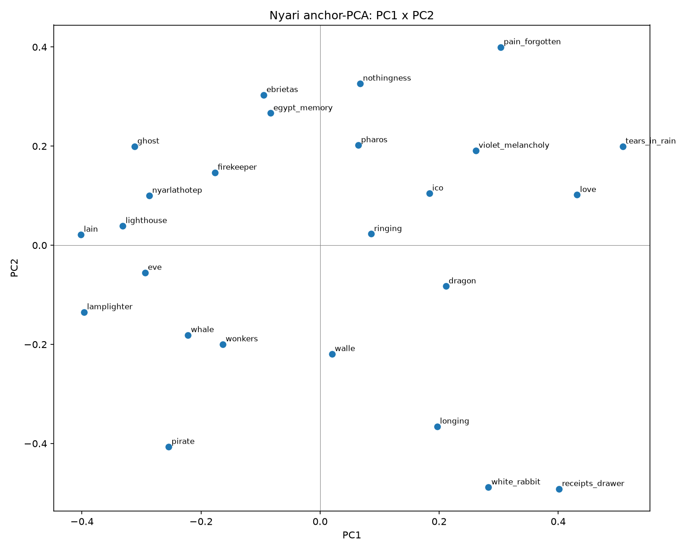

# Mind Atlas — tomography of a language model's persona geometry

**Thesis.** A language model's behaviour is not stored as a lookup table but as a *geometry* in its representation space; weights are one way to reach it, but not the only way. If so, the geometry can be mapped from the outside the way a CT scanner maps a body: each fixed battery of questions is one *projection* of the model's concept space, and *rotating the basis* (language, persona/framing, temperature, model head) while accumulating projections should make the underlying manifold reconstructible (Radon / compressed-sensing logic). A corollary is **learning without weights**: if behaviour is existing geometry, then context acts as a *rotation* of that space, and RL mostly reinforces or shifts directions already present in the base model. A short, structured block of context can therefore function as a symbolic *steering vector*. We call such blocks **態語 (taigo, "state language")** and measure them by contrastive ablation. This repository holds the preregistered batteries, raw collections, analysis code and — deliberately — the negative results.



*Anchor-PCA: 25 hand-chosen anchor concepts, mean-centred, PCA of sentence embeddings. Preregistered axis predictions **failed** (see `results/anchor-pca-09-19.md`) — reported as-is.*

## What is here

| dir | what | status |
|---|---|---|
| `vocab/`, `vocab.json` | ~1,750-concept multilingual (EN/DE/JA/ZH) vocabulary, domain-layered, schema + validators | done |
| `battery-v2/` | preregistered projection battery: 11 questions × 10 bases (4 languages, 3 framings, 4 model heads), N≥5 independent lanes per cell, 900 lanes + rider, pass-gate against v1 anchors | M0 collected (`PREREG.md`, `results/`) |
| `lighthouse-invariant/` | hypothesis H1: a concept ("lighthouse") is a persona-invariant attractor in the weights. 540 trials, 2 heads, preregistered 5-condition rule | **H1 rejected** (`results/FINAL-lighthouse-r5.md`) |
| `hearth-invariant/` | sibling invariance probe (codex head) | partial |
| `anchor-pca` (`scripts/anchor_pca.py`, `anchors/`) | anchor-cloud PCA, prereg vs hand-labelled axes | **both prereg predictions failed** |
| `taigo/` | 態語 v0: 8-line state block, 40 probes, line-level + subset ablation, 5-axis rubric | block effect ≈ 13 pts on a 25-pt rubric; one line (宇宙) carries ≈ half of it; n=8/cell, same-family scorer — see caveats in `RESULTS-v0.md` |
| `ideology-overlay/` | stage 1: embed & align discourse corpora (left/right/QAnon/UFO/scripture) to look for shared skeleton | stage 1 |
| `docs/thinking-suppression.md` | notes on suppressing adaptive thinking via context placement/naming (research notes, JA) | notes |
| `ROADMAP.md` | M0→M4 campaign plan (collect → rotate → reconstruct → field engine) | plan |

Design laws used throughout: N≥5 independent lanes per cell · explicit scales · disagreement between heads is data · preregistered decision gates, never edited post hoc (`gates/forbidden-decision-gates.json`) · every aggregate regenerated by script, never hand-tallied.

## How to run

Python 3.10+, `numpy`; `sentence-transformers` + `torch` for the embedding scripts; `bun` for `taigo/`.

```bash
python3 scripts/check_all.py          # unit tests → vocab validator → decision-gate bans (must be green before any claim)
python3 scripts/anchor_pca.py         # anchor-PCA (downloads all-mpnet-base-v2)
python3 battery-v2/scripts/tabulate.py --help   # re-aggregate battery-v2 from the committed coded-*.tsv
bun run taigo/run.ts && bun run taigo/score.ts  # 態語 experiment (needs an agent runner, see taigo/README.md)
```

Collection scripts (`battery-v2/scripts/dispatch_lanes.py`, `harvest_rooms.py`, `taigo/lib/summon.ts`) drive a private multi-agent harness (`gaia summon`) and are published as method documentation; the committed `raw/` and `coded-*.tsv` files are the data, so analysis re-runs without the harness. Internal room identifiers were replaced by stable hashes (`room-<sha1[:10]>`), preserving the 1:1 lane↔room integrity checks. One real-transcript test fixture is not published, so its two tests skip.

No large artefacts are committed (largest tracked file < 1 MB). Embedding caches and model downloads are regenerated by the scripts above and are git-ignored.

## Citations / prior art

- Chen, Arditi, Sleight, Evans, Lindsey. **Persona Vectors: Monitoring and Controlling Character Traits in Language Models.** Anthropic, 2025. arXiv:2507.21509.
- Vogel, T. (vgel). **repeng** — representation engineering / control vectors for LLMs. https://github.com/vgel/repeng
- Yue, Chen, Lu, Zhao, Wang, Song, Huang. **Does Reinforcement Learning Really Incentivize Reasoning Capacity in LLMs Beyond the Base Model?** 2025. arXiv:2504.13837 (pass@k: RL-trained models bounded by their base).

## License

MIT © Pascal Disse — see `LICENSE`.
